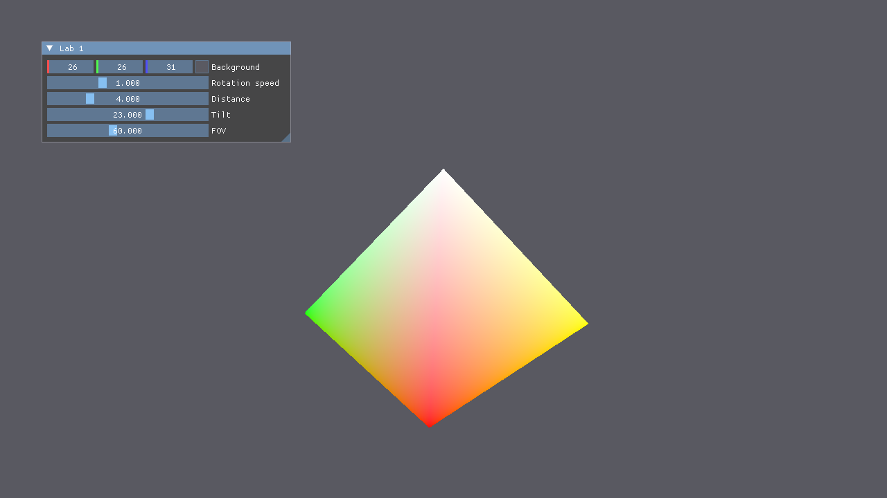
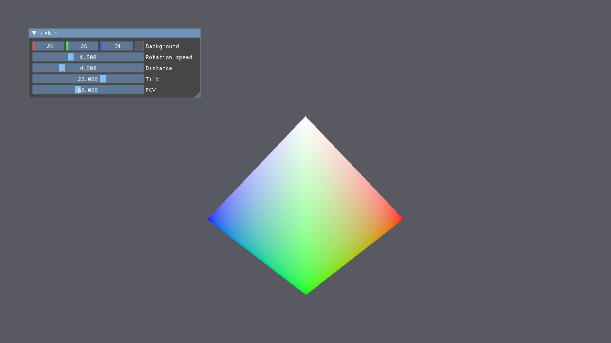

# Лабораторная работа №1. Основы 3D-графики

**Вариант 6 — пирамида.**



## Условие

Познакомиться с основами 3D-графики: построить простой 3D-объект, спроецировать его на 2D-плоскость, поработать
с матрицей перспективной проекции и аффинными преобразованиями. Использовать Vulkan, GLFW и ImGui. Программа
работает в реальном времени, объект корректно отрисовывается с учётом проекции, пользователь может с ним
взаимодействовать. Полное условие — [CGLab#1.pdf](CGLab%231.pdf).

Выполнен основной вариант (оценка 3), без дополнительных заданий.

## Что сделано

- Правильная четырёхугольная пирамида: 5 вершин, 6 треугольников (4 боковые грани + основание из двух), 18 индексов.
  У каждой вершины свой цвет, внутри граней цвета интерполируются.
- Вершинный и индексный буферы, uniform-буфер с матрицей `mvp` (память выделяется через VMA).
- Набор дескрипторов (`VkDescriptorSet`), через который uniform-буфер попадает в вершинный шейдер.
- Graphics pipeline с тестом глубины и отсечением задних граней.
- Матрицы написаны вручную ([source/math.hpp](../source/math.hpp)): поворот вокруг X и Y, перенос, перспективная
  проекция под Vulkan (ось Y вниз, глубина в [0, 1]).
- `mvp = projection · view · model`, где `model` — поворот пирамиды вокруг вертикальной оси,
  `view` — отодвинуть сцену на расстояние камеры и наклонить, `projection` — перспектива.

## Зависимости (Linux Mint 22 / Ubuntu 24.04)

```bash
sudo apt install vulkan-validationlayers glslc \
    libwayland-dev libxkbcommon-dev wayland-protocols \
    libxrandr-dev libxinerama-dev libxcursor-dev libxi-dev
```

Системные заголовки Vulkan в Ubuntu 24.04 (1.3.275) слишком старые для vk-bootstrap 1.4.321, поэтому нужны свежие:

```bash
git clone --depth 1 --branch v1.4.321 https://github.com/KhronosGroup/Vulkan-Headers.git ~/libs/Vulkan-Headers
```

и файл `CMakeUserPresets.json` в корне репозитория (путь — абсолютный):

```json
{
	"version": 2,
	"configurePresets": [
		{
			"name": "local-debug",
			"inherits": "debug",
			"cacheVariables": {
				"Vulkan_INCLUDE_DIR": "/home/<user>/libs/Vulkan-Headers/include"
			}
		}
	]
}
```

## Сборка и запуск

Из корня репозитория:

```bash
cmake --preset local-debug
cmake --build build-debug --parallel
./build-debug/vulkan-starter-app
```

Запускать нужно **из корня репозитория**: шейдеры загружаются по относительному пути `shaders/*.spv`.
Шейдеры компилируются `glslc` автоматически во время сборки.

## Управление

Окно «Lab 1»:

| Элемент | Что делает |
|---------|------------|
| Background | Цвет фона |
| Rotation speed | Скорость вращения пирамиды, рад/с (0 — остановить) |
| Distance | Расстояние от камеры до пирамиды |
| Tilt | Наклон камеры в градусах: > 0 — смотрим сверху, < 0 — снизу (видно основание) |
| FOV | Вертикальный угол обзора перспективной проекции, градусы |



## Структура кода

| Файл | Содержимое |
|------|-----------|
| [source/application.cpp](../source/application.cpp) | Геометрия пирамиды, создание буферов, дескрипторов и pipeline, интерфейс, расчёт матриц, запись команд отрисовки |
| [source/math.hpp](../source/math.hpp) | Матрица 4×4 и преобразования |
| [source/graphics.hpp](../source/graphics.hpp), [source/graphics.cpp](../source/graphics.cpp) | Загрузка шейдеров, создание буферов через VMA |
| [shaders/pyramid.vert](../shaders/pyramid.vert), [shaders/pyramid.frag](../shaders/pyramid.frag) | Вершинный и фрагментный шейдеры |
